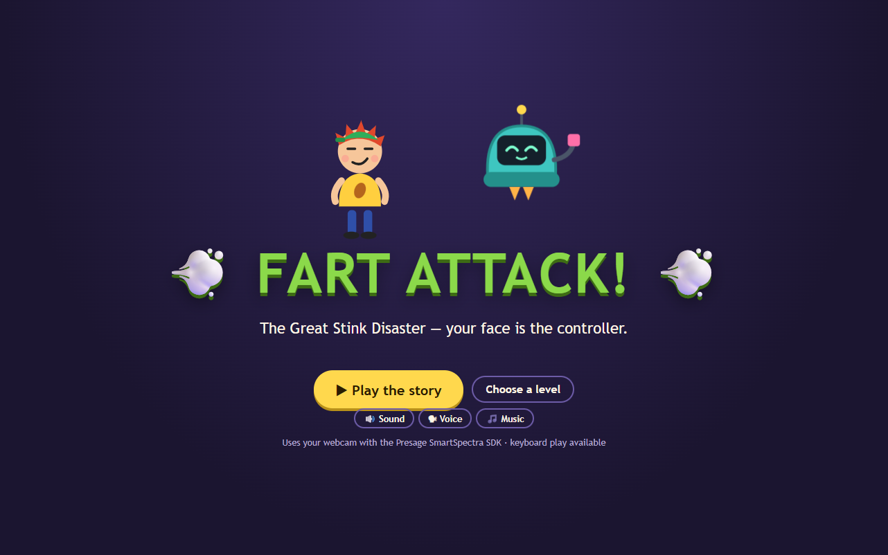
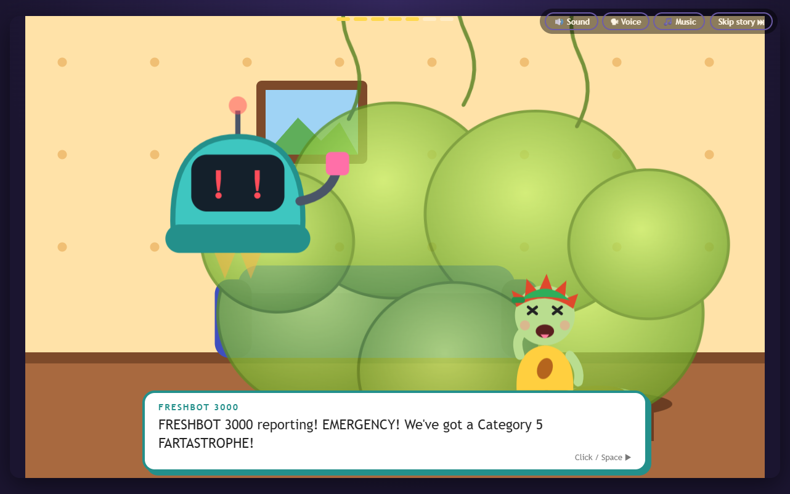
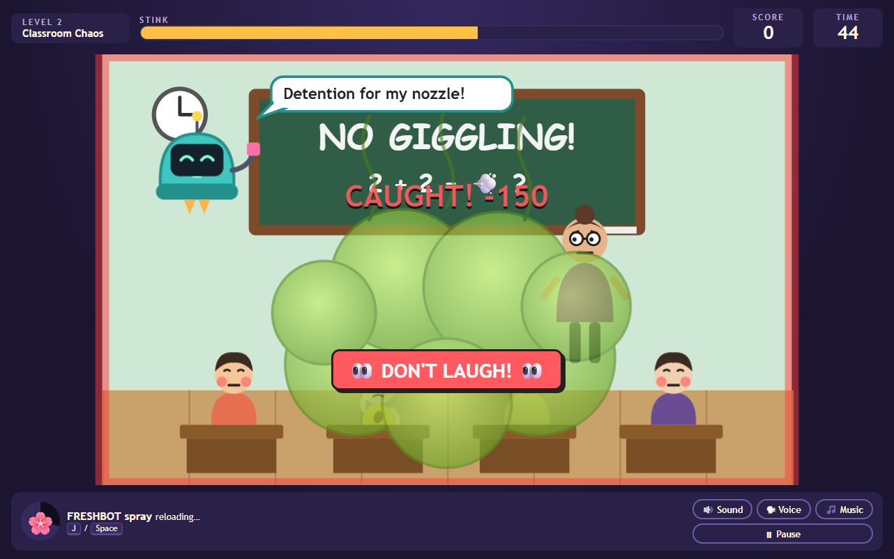
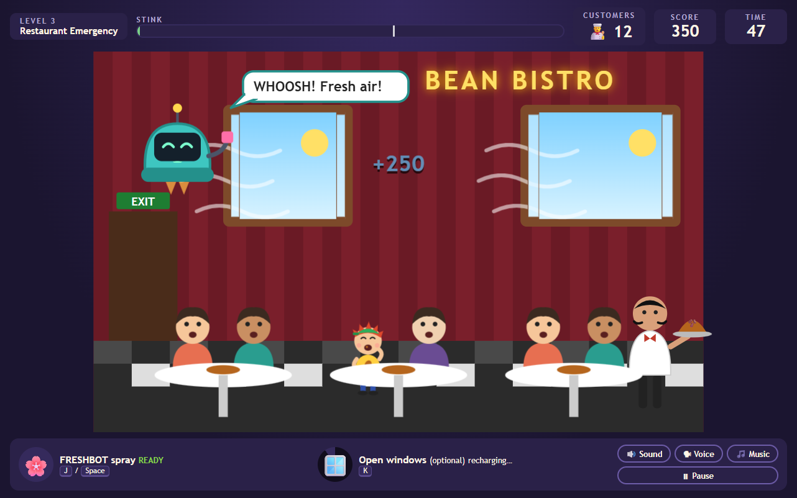

# 💨 Fart Attack!

### Your face is the controller. Your expressions save the room.

A funny Windows arcade game played with your webcam. A cartoon fart cloud is taking over the room, and the only way to clear it is with your face: **smile** to switch on the air freshener, and (optionally) pull a **surprised face** to throw the windows open. Live expression estimates come from the [Presage SmartSpectra SDK](https://smartspectra.presagetech.com/docs/).

Built for the **Presage SmartSpectra SDK Challenge 2026** with Electron, React and TypeScript. Open source under the [MIT License](LICENSE).

> ### ▶ [Watch the demo video](https://youtu.be/Hl-m65fbLs4)

<p align="center">
  
  
</p>
<p align="center">
  
  
</p>

*These screenshots were captured in keyboard-only mode (no camera). With the camera on, a live face preview with Smile / Surprise indicators appears in the bottom-right corner of the game screen.*

**On this page:** [Try it](#try-it-in-two-minutes) · [The game](#the-game) · [SmartSpectra](#how-smartspectra-is-used) · [Requirements](#requirements--compatibility) · [Install](#install-and-run) · [Controls](#controls) · [Privacy](#privacy-and-data-handling) · [Tests](#tests-and-verification) · [Troubleshooting](#troubleshooting) · [Architecture](#under-the-hood)

---

## Try it in two minutes

You do **not** need a camera or an API key to see the whole game. Everything has a keyboard equivalent.

```powershell
git clone https://github.com/osodotsol/fart-attack
cd fart-attack
npm install            # in PowerShell use npm.cmd if script execution is disabled
npm start              # then choose "Play the story" and "Play with keyboard only"
```

Requirements: Windows 10/11 (x64) and Node.js 24 or newer. To play with your face you also need a webcam, an internet connection and your own Presage API key; see [Requirements & compatibility](#requirements--compatibility).

---

## The game

You are the city's newly recruited **Stink Control Hero**. **Bean Kid** loves beans and has a serious problem. **FRESHBOT 3000**, a chatty cleaning robot, can only spray when your face tells it to. A voiced story links the levels (opening, school, restaurant, finale), and you finish with a score and a funny rank, from *Professional Nose-Holder* up to *SUPREME MINISTER OF FRESH AIR*.

| Level | Story | What makes it different |
|---|---|---|
| **1 · Living Room Disaster** (45 s) | Bean Kid has contaminated the family living room. | The tutorial: slow farts, smile-powered spraying. |
| **2 · Classroom Chaos** (55 s) | He brought his beans to school. | **DON'T LAUGH!** See below. |
| **3 · Restaurant Emergency** (60 s) | He ordered the biggest plate of beans on the menu. | Every third fart is a **MEGA fart**, and customers walk out while the stink stays high. |

### The two facial controls

- 😀 **Smile → freshener.** A quick smile sprays for 4 seconds, then the spray reloads for 2 seconds. Holding a smile does not fire twice, so you never have to grin continuously.
- 😮 **Surprised face → open the windows** (Level 3, **optional**). A bigger, faster stink fix. Surprise is the less reliable of the two expressions, so it is never required: the whole game, including Level 3, can be won with smiles only, and **K** is the keyboard alternative.

### The Classroom twist

Smiling is the weapon, so Level 2 turns it into the risk. The teacher turns round after a short warning, and while she is watching, a *new* spray gets you caught: **−150 points, extra stink and a confiscated spray**. A smile that helps you one second can hurt you the next, so you have to watch the teacher and time your face. Classroom is intentionally the hardest level. Missing or invalid readings are never treated as a calm face, so a lost signal cannot silently help or hurt you.

### Features

- Three levels with their own rules, a complete story with recurring characters, and a finale
- Live webcam controls through SmartSpectra, with short, debounced gestures
- **Keyboard fallback** for every action, including keyboard-only play with no camera or API key at all
- In-game **facecam** with live Smile / Surprise indicators (show or hide with **F**); it clears whenever the camera stops
- Explicit **camera consent** screen and a **practice screen** before play
- Spoken dialogue using **offline Windows voices** (subtitles always shown), original sound effects and music generated in code (no audio files), and separate Sound / Voice / Music switches
- Scoring with combos, a fresh-air bonus, a customer bonus and ranks
- Camera trouble handling: if no readings arrive within 30 s you get **Retry** or **Play with keyboard**; if the signal drops during play the game pauses, you can continue on the keyboard, and you restore camera control deliberately

---

## How SmartSpectra is used

- The app requests the SDK's **face metrics** and reads the **expression estimates** (confidence 0–100 per expression, about 30 readings per second). Only **happy** (smile) and **surprise** drive the game.
- These are estimates of **facial movement**, not of how someone feels. There are no emotion or health claims.
- The SDK runs in Electron's **main process**. The UI never sees the API key; it only receives small normalised readings and a mirrored preview frame through a narrow preload bridge.
- A gesture layer turns the noisy stream into fair controls:

  | Gesture | Fires when | Re-arms when |
  |---|---|---|
  | Smile → freshener | happy ≥ 60% for 5 consecutive readings (~160 ms) | happy < 45% for 8 readings |
  | Surprise → windows | surprise ≥ 40% for 5 readings | surprise < 20% for 8 readings |

  Readings are ignored when the SDK reports an invalid measurement (for example "too dark" or "no face"), and missing scores are never treated as a neutral face. The on-screen LIVE badge and indicator readings show only while fresh readings and preview frames are actually arriving.
- **Why only two expressions?** On the hardware tested, disgust, blinking and talking were not reliable enough to build gameplay on; smile was very reliable and surprise usable with a live preview. The evidence is in [`docs/SDK_VALIDATION.md`](docs/SDK_VALIDATION.md).

---

## Requirements & compatibility

- **Windows 10 or 11 (x64)**. Developed and tested on Windows 11; other platforms are not supported.
- **Node.js 24** (LTS) or newer, and npm.
- **Keyboard-only play** needs nothing else: no camera, no internet and no API key.
- **Camera play** needs a webcam, an internet connection while the camera is on (the SDK contacts Presage's servers; see [Privacy](#privacy-and-data-handling)), and your own **Presage API key** from the [Presage developer portal](https://physiology.presagetech.com/). Camera sessions use your own API quota.
- Expression recognition varies between people, lighting and cameras. Smile is the reliable control; surprise is weaker and always optional.
- Optional: an English Windows text-to-speech voice for narration (subtitles are always shown).

## Install and run

**Setup**

```powershell
git clone https://github.com/osodotsol/fart-attack
cd fart-attack
npm install            # in PowerShell use npm.cmd if script execution is disabled
copy .env.example .env
```

Edit `.env` and set your key:

```
SMARTSPECTRA_API_KEY=your-key-here
# Optional: pick a specific camera (list them with: npm run probe -- --list-cameras)
SMARTSPECTRA_CAMERA_ID=
```

**Run**

```powershell
npm start
```

`npm start` builds the app and launches it. Without a key you can still choose **Play with keyboard only**. The `.env` file is git-ignored; never commit a real key.

---

## Controls

| Where | Key / action | Does |
|---|---|---|
| Camera | **Smile** (quick) | Freshener sprays for 4 s |
| Camera | **Surprised face** | Open windows (Level 3, optional) |
| Keyboard | **J** or **Space** | Freshener (fallback) |
| Keyboard | **K** | Open windows (Level 3, fallback) |
| Game | **P** or **Esc** | Pause (menu has *Quit & turn camera off*) |
| Game | **M** | Mute / unmute all audio |
| Game | **F** | Show / hide the facecam (the camera keeps running) |
| Game | **C** | Restore camera control after a keyboard fallback |
| Story | **Space / Enter**, **Esc** | Next panel, skip the story |

**Scoring:** spray +100, windows +250, combo ×1.5 up to ×3 for actions within 2.5 s, a fresh-air bonus at the end, +100 per customer kept in Level 3, and −150 if the teacher catches you in Level 2.

---

## Privacy and data handling

- **Explicit consent first.** The camera is never started until you click through the consent screen, which explains what it is for.
- **The game stores nothing.** It saves no video, photos or face data. Expression readings and the preview frame live in memory during the session only. The game writes no files, database or settings of its own (audio switches are not saved either). Electron keeps its usual internal browser files (cache, logs) in your user profile folder; camera frames and readings are never written there.
- **Network.** The SDK needs the internet: it contacts Presage's servers to check your API key and download its models. **SDK telemetry is disabled** (`enableTelemetry: false`), and the game adds no analytics or network calls of its own.
- **API key.** Read from `.env` by the main process only; never exposed to the UI.
- **Voices.** Narration uses only voices installed on your PC (`localService`); dialogue text is not sent to a speech service. Sound effects and music are generated in code.
- **Stopping.** *Quit camera* and *Quit & turn camera off* stop the SDK session. Reloading the window, a renderer crash or closing the window also stop it (see [Tests and verification](#tests-and-verification)).
- **Electron hardening.** Context isolation, sandbox, no Node integration in the UI, a strict Content-Security-Policy, blocked navigation and popups, denied web permissions, and IPC accepted only from the app's own window and page.
- **Not a medical device.** Expression estimates are not emotion recognition and make no health claims.

---

## Tests and verification

```powershell
npm test               # unit and integration tests (Vitest)
npm run typecheck      # TypeScript
npm run check          # typecheck + tests + production build
npm run snap -- out    # camera-free screenshots of every screen (keyboard mode)
npm run verify:offline # end-to-end UI check in a hidden window
node scripts/launch.mjs --script scripts/verify-lifecycle.cjs   # camera ownership lifecycle check
```

**What is verified, and how**

| Area | Evidence |
|---|---|
| Logic, gestures, levels, SDK adapter, startup recovery, fresh-signal display | Automated unit and integration tests (152 at the time of writing) |
| Full UI flow: story, controls, three keyboard campaign levels, camera fallback, facecam layout, startup watchdog | `verify:offline`, which drives the real built app with a **simulated** face feed (clearly labelled SIMULATION). It never loads the SDK or opens the camera. |
| Camera ownership: window reload, renderer crash, window close, delayed teardown, startup timeout and retry | `verify-lifecycle.cjs`, which runs the real main process, preload and UI against an **SDK stand-in**. It proves the start/stop/destroy calls and their ordering, not native camera behaviour. |
| Live SmartSpectra | One controlled real-camera session validated consent and start, live smile and surprise recognition, smile-driven play through all three levels and the finale, and a normal quit. The author also observed the physical webcam turn off after exiting the game during a genuine SDK session. Details: [`docs/SDK_VALIDATION.md`](docs/SDK_VALIDATION.md). |

## Troubleshooting

| Problem | Fix |
|---|---|
| PowerShell says running scripts is disabled | Use `npm.cmd` instead of `npm`, or allow scripts for your user. |
| The app does not open a window | Start it with `npm start` (it clears `ELECTRON_RUN_AS_NODE`). |
| "No SmartSpectra API key" | Create `.env` as above, or play keyboard-only. |
| "Warming up the face sensor…" takes long, or "Couldn't reach Presage's servers" | The sensor needs the internet; it took 6–26 s in testing. After 30 s with no readings the game offers **Retry** or **Play with keyboard**. Check your network or DNS (a different network or DNS server helps). There is no automatic retry. |
| "Model not available" / server busy | A temporary Presage-side message: wait a moment and Retry. |
| "Too dark", "One face at a time", "Move closer" | Light your face, keep one face in view, face the camera. |
| Camera busy | Close other apps using the webcam (video calls, recorders). |
| No narration | An English offline Windows voice is needed; subtitles always work. |
| Surprise does not trigger | It is the weaker signal and always optional; press **K**. |

---

## Under the hood

```
 Webcam ─► SmartSpectra SDK ──────────────┐   (Electron main process; holds the API key)
                                          ▼
                       FaceService: normalise metrics, preview frame, safe errors
                                          │  narrow preload bridge (IPC checked)
                                          ▼
  React UI ─► faceStore ─► gesture layer (thresholds, debounce, re-arm, validity)
                                          ▼
                          pure game engine (levels, teacher, customers, scoring)
```

```
src/main        Electron main process, SDK service, renderer-lifetime ownership, IPC guard
src/preload     minimal contextBridge API
src/renderer    React UI: screens, cutscenes, scenes (SVG), audio, voice, facecam
src/sdk         pure adapters: SDK metrics → readings, preview-frame packing
src/game        pure logic: engine, levels, gestures, input mode, story
src/shared      types shared across processes
tests/          unit and integration tests (Vitest)
scripts/        launcher and development tools
tools/sdk-probe live SDK diagnostic used to validate which expressions are reliable
docs/           PRD, architecture decisions, SDK research, validation evidence
```

**More detail:** [`docs/PRD.md`](docs/PRD.md) (product requirements) · [`docs/DECISIONS.md`](docs/DECISIONS.md) (architecture decisions) · [`docs/SDK_RESEARCH.md`](docs/SDK_RESEARCH.md) (SDK findings) · [`docs/SDK_VALIDATION.md`](docs/SDK_VALIDATION.md) (live validation evidence)

---

## Third-party software

Electron, React, Vite, Vitest, esbuild and TypeScript are open source under their own licences. `@smartspectra/node-sdk` is proprietary software provided by Presage Technologies under [Presage's Terms of Service](https://physiology.presagetech.com/tos); it is installed from npm as a dependency and is **not** redistributed in this repository. No Presage sample code was copied.

## License

Released under the [MIT License](LICENSE). Copyright © 2026 Samuel Oti.

The Presage SmartSpectra SDK is a separate dependency under its own terms (see *Third-party software* above).
